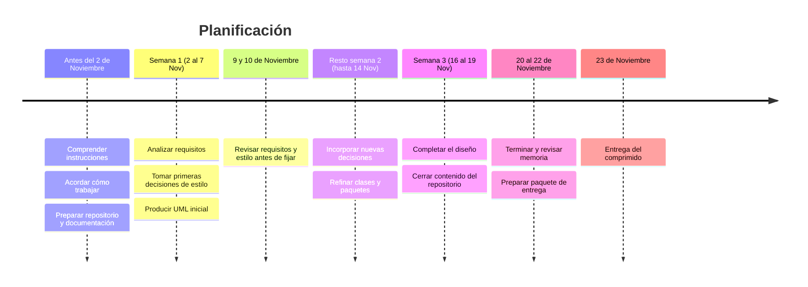
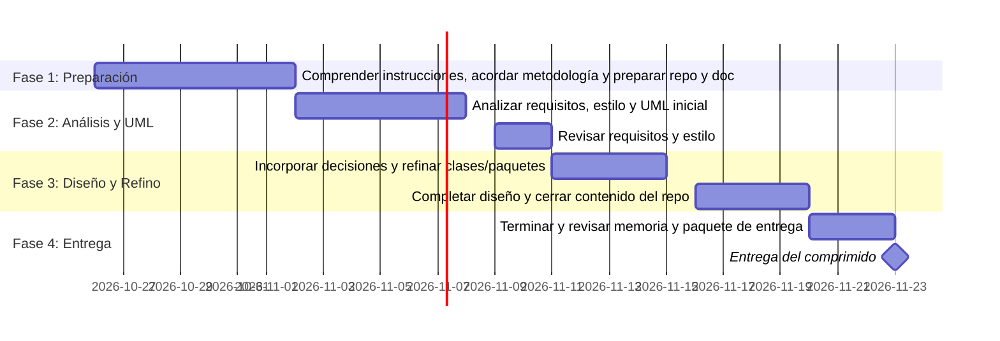

# Práctica DAS

> Plataforma web responsiva para periódicos digitales con sistema de suscripciones anónimas, pasarela de pago recurrente y analítica para redactores.

---

## 📌 Visión General

Este repositorio contiene la especificación de requisitos, las decisiones de diseño de arquitectura (ADRs) y los modelos UML para un **Periódico Digital** multi-dispositivo.

El sistema permite a los lectores consumir noticias y suscribirse de forma anónima a canales temáticos, gestionar planes de pago recurrentes integrados con Stripe y proporcionar a los administradores métricas clave de uso y conversión.

---

## Roadmap

---

---

## Punto de entrada

| Contenido | Acceso |
| --- | --- |
| Requisitos funcionales y de dominio | [Requisitos](Requisitos/requisitos.md) |
| Decisiones arquitectónicas | [Decisiones](Decisiones/) |
| Plantilla MADR | [Plantilla de decisión](Decisiones/Plantillas/plantilla-madr.md) |
| Discusiones y revisiones | [Discusiones](Decisiones/Discusiones/) |
| Diagramas UML por iteración | [Arquitecturas](Arquitecturas/) |

---

## 👥 Equipo de Arquitectura Software

* **ASS 1 (Senior Software Architect):** [Paula de la Fuente Ruiz](https://github.com/Paula-2704)
* **ASS 2 (Senior Software Architect):** [Marcos Vidal Castillo](https://github.com/Marcos-VC)
* **ASC 1 (Cognitive Software Architect):** [Francisco García González](https://github.com/Fran-G-G)
* **ASC 2 (Cognitive Software Architect):** [Fernán Rama Hombreiro](https://github.com/fernanrama)
* **ASJ (Junior Software Architect / Modeler):** [Álvaro Fernández Jiménez](https://github.com/minicruck)

---

## 📄 Licencia

Este proyecto está bajo la Licencia MIT. Consulta el archivo `LICENSE` para más detalles.
