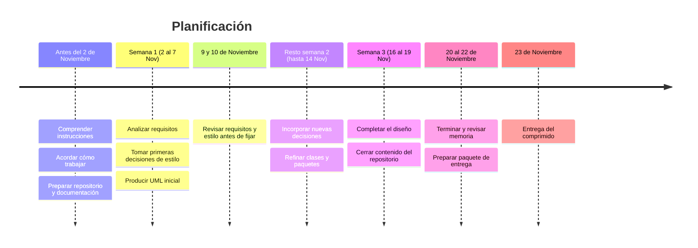
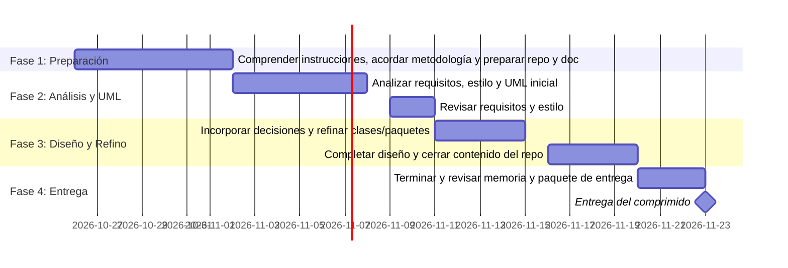

# Practica-DAS

> Plataforma web responsiva para periódicos digitales con sistema de suscripciones anónimas, pasarela de pago recurrente y analítica para redactores.

---

## 📌 Visión General

Este repositorio contiene la especificación de requisitos, las decisiones de diseño de arquitectura (ADRs) y los modelos UML para un **Periódico Digital** multi-dispositivo.

El sistema permite a los lectores consumir noticias y suscribirse de forma anónima a canales temáticos, gestionar planes de pago recurrentes integrados con Stripe y proporcionar a los administradores métricas clave de uso y conversión.

---

## Roadmap

---

---

## 📄 Documentación Completa

Puedes consultar el informe técnico completo y la memoria del proyecto en el siguiente enlace:
* 📥 [Descargar Memoria de la Práctica (PDF)](./Documentacion/Memoria_DAS_P1.pdf)

---

## 🛠️ Estructura del Repositorio

* **Requisitos/** - Especificación detallada de requisitos funcionales (RF) y de dominio
* **Decisiones/** - Registros de Decisiones Arquitectónicas en formato MADR
* **Arquitecturas/** - Diagramas UML de clases y paquetes por iteración (SVG / PNG)

---

## 🏗️ Estilo y Decisiones Arquitectónicas

La arquitectura del sistema responde a los requisitos de desacoplamiento, adaptabilidad responsive y aislamiento de datos:

* **Front-end Web Responsivo:** Adaptación dinámica según dispositivo (PC, Tablet) mediante APIs HTTP/REST.
* **Persistencia Segregada:** Uso de bases de datos PostgreSQL independientes para el dominio administrativo/redacción y el dominio de suscriptores.
* **Integración de Pagos:** Módulo de pagos recurrentes con Stripe y lógica de reintentos (hasta 3 intentos) ante fallos de transacción.
* **Patrones y Estilos:** Capturados progresivamente en la carpeta `Decisiones/` usando la notación MADR.

---

## 📋 Módulos y Requisitos Principales

* **RF1 - Gestión de Contenidos y Lectura:** Discriminación de clientes (PC/Tablet), navegación HTTP/REST por categorías (Política, Economía, Sociedad, Nacional, Internacional).
* **RF2 - Canal de Suscripciones Anónimas:** Alta y baja de lectores en canales temáticos preservando la privacidad.
* **RF3 - Pasarela y Facturación (Stripe):** Gestión de suscripciones Trimestral (70€), Semestral (130€) y Anual (190€), con reintentos automáticos de pago.
* **RF4 - Módulo de Estadísticas y Analítica:** Panel para redactores con noticias más leídas, tiempo de permanencia, tasa de rebote y tasa de conversión.
* **RF5 - Gestión de Persistencia Dual:** Almacenamiento segregado en PostgreSQL para datos de suscriptores y gestión editorial.

---

## 👥 Equipo de Arquitectura Software

* **ASS 1 (Senior Software Architect):** [Paula de la Fuente Ruiz] (https://github.com/Paula-2704)
* **ASS 2 (Senior Software Architect):** [Marcos Vidal Castillo] (https://github.com/Marcos-VC)
* **ASC 1 (Cognitive Software Architect):** [Francisco García González] (https://github.com/Fran-G-G)
* **ASC 2 (Cognitive Software Architect):** [Fernán Rama Hombreiro] (https://github.com/fernanrama)
* **ASJ (Junior Software Architect / Modeler):** [Álvaro Fernández Jiménez] (https://github.com/minicruck)

---

## 📄 Licencia

Este proyecto está bajo la Licencia MIT. Consulta el archivo `LICENSE` para más detalles.
